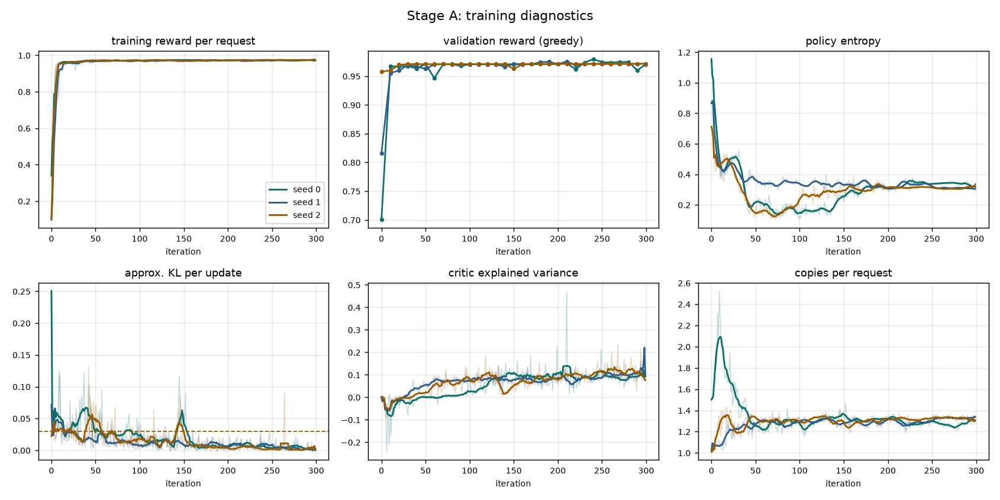
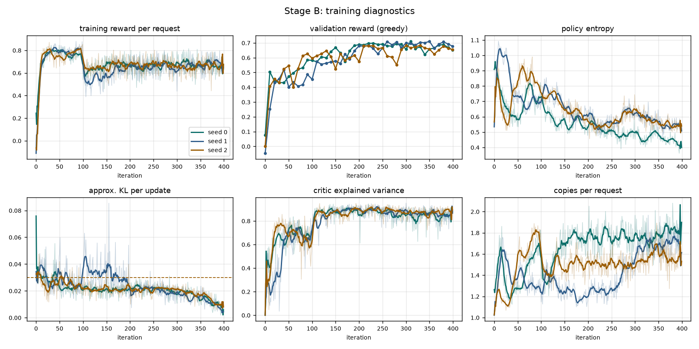
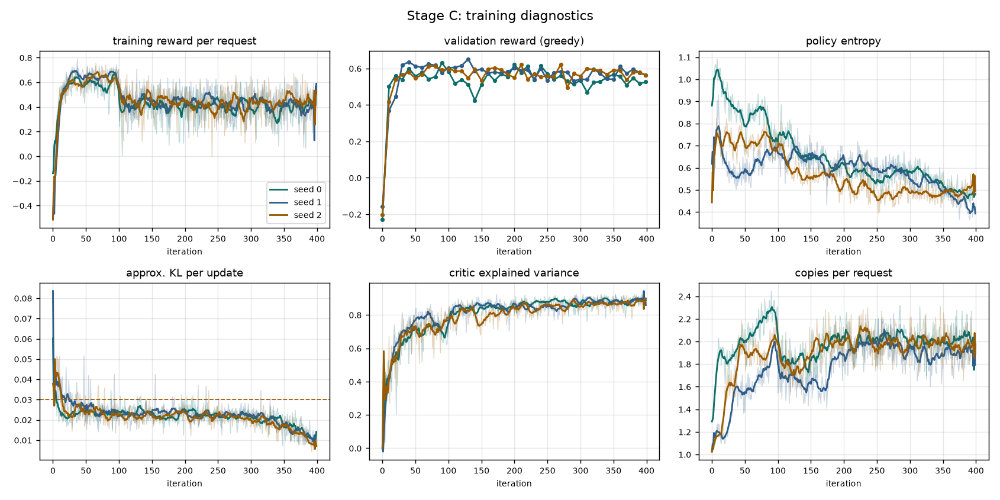
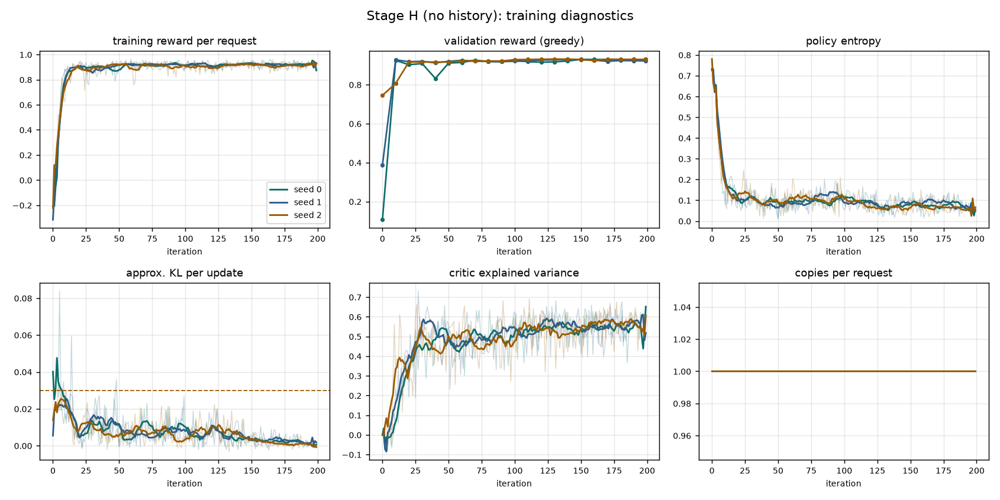
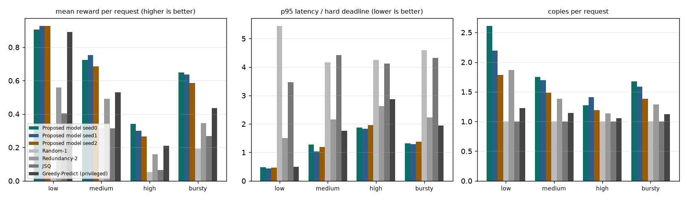
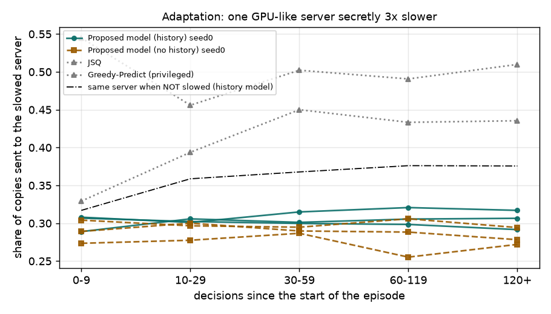
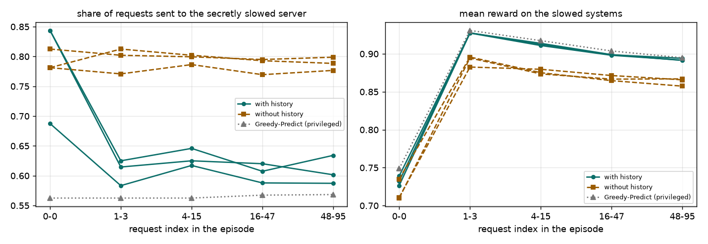

# Convergence check: report

Synthetic data only. Everything (simulator, data, model, training, evaluation) is in this folder; nothing from the measured datasets or other project code is used. The checks follow Section 8 ("Step 0: convergence demo on synthetic data") of the method documentation.

## 1. Does training converge?

Criteria (documentation Section 8.3): reward rises then flattens; seeds agree (final validation reward within about ±5%); the critic explains more of the returns over time; entropy falls gradually (no collapse); the policy change per update (approx. KL) stays small (about 0.01–0.03).

### Stage A

| Seed | validation reward start → final (best) | slope, last quarter (per 100 it) | entropy start → end | median KL | explained var. start → end | copies/request (end) | minutes |
|---|---|---|---|---|---|---|---|
| 0 | 0.700 → 0.968 (0.980) | -0.014 | 0.58 → 0.34 | 0.0123 | -0.04 → 0.09 | 1.28 | 43.2 |
| 1 | 0.816 → 0.971 (0.976) | 0.000 | 0.50 → 0.31 | 0.0077 | -0.02 → 0.10 | 1.32 | 47.7 |
| 2 | 0.958 → 0.971 (0.972) | 0.000 | 0.48 → 0.31 | 0.0079 | -0.02 → 0.11 | 1.33 | 44.2 |

Final validation reward across seeds: mean 0.970, spread 0.003 (0.3% of the mean).

| Criterion | Result |
|---|---|
| reward improves from the start | PASS |
| reward flattens (small slope at the end) | PASS |
| 3 seeds agree (spread ≤ 10% of mean or ≤ 0.03) | PASS |
| critic explained variance rises (> 0.3 at the end; Stage A: > half its noise ceiling) | PASS |
| entropy falls gradually, no premature collapse | PASS |
| policy change per update small | FAIL |

### Stage B

| Seed | validation reward start → final (best) | slope, last quarter (per 100 it) | entropy start → end | median KL | explained var. start → end | copies/request (end) | minutes |
|---|---|---|---|---|---|---|---|
| 0 | 0.077 → 0.670 (0.711) | -0.004 | 0.74 → 0.46 | 0.0209 | 0.55 → 0.84 | 1.79 | 36.6 |
| 1 | -0.047 → 0.692 (0.710) | -0.011 | 0.92 → 0.56 | 0.0213 | 0.31 → 0.86 | 1.70 | 37.0 |
| 2 | 0.002 → 0.665 (0.684) | -0.022 | 0.67 → 0.56 | 0.0211 | 0.57 → 0.87 | 1.58 | 38.5 |

Final validation reward across seeds: mean 0.676, spread 0.027 (4.0% of the mean).

| Criterion | Result |
|---|---|
| reward improves from the start | PASS |
| reward flattens (small slope at the end) | PASS |
| 3 seeds agree (spread ≤ 10% of mean or ≤ 0.03) | PASS |
| critic explained variance rises (> 0.3 at the end; Stage A: > half its noise ceiling) | PASS |
| entropy falls gradually, no premature collapse | PASS |
| policy change per update small | FAIL |

### Stage C

| Seed | validation reward start → final (best) | slope, last quarter (per 100 it) | entropy start → end | median KL | explained var. start → end | copies/request (end) | minutes |
|---|---|---|---|---|---|---|---|
| 0 | -0.230 → 0.530 (0.630) | 0.016 | 0.94 → 0.51 | 0.0218 | 0.51 → 0.88 | 2.00 | 35.4 |
| 1 | -0.159 → 0.578 (0.651) | 0.029 | 0.64 → 0.48 | 0.0226 | 0.53 → 0.88 | 1.90 | 36.2 |
| 2 | -0.201 → 0.573 (0.622) | -0.016 | 0.70 → 0.49 | 0.0213 | 0.52 → 0.87 | 1.98 | 32.9 |

Final validation reward across seeds: mean 0.560, spread 0.049 (8.7% of the mean).

| Criterion | Result |
|---|---|
| reward improves from the start | PASS |
| reward flattens (small slope at the end) | PASS |
| 3 seeds agree (spread ≤ 10% of mean or ≤ 0.03) | PASS |
| critic explained variance rises (> 0.3 at the end; Stage A: > half its noise ceiling) | PASS |
| entropy falls gradually, no premature collapse | PASS |
| policy change per update small | PASS |

### Stage H

| Seed | validation reward start → final (best) | slope, last quarter (per 100 it) | entropy start → end | median KL | explained var. start → end | copies/request (end) | minutes |
|---|---|---|---|---|---|---|---|
| 0 | 0.107 → 0.929 (0.930) | -0.001 | 0.30 → 0.07 | 0.0050 | 0.10 → 0.55 | 1.00 | 9.2 |
| 1 | 0.388 → 0.923 (0.930) | -0.010 | 0.31 → 0.08 | 0.0051 | 0.16 → 0.56 | 1.00 | 9.4 |
| 2 | 0.745 → 0.930 (0.932) | 0.006 | 0.29 → 0.06 | 0.0049 | 0.23 → 0.57 | 1.00 | 9.4 |

Final validation reward across seeds: mean 0.928, spread 0.007 (0.8% of the mean).

| Criterion | Result |
|---|---|
| reward improves from the start | PASS |
| reward flattens (small slope at the end) | PASS |
| 3 seeds agree (spread ≤ 10% of mean or ≤ 0.03) | PASS |
| critic explained variance rises (> 0.3 at the end; Stage A: > half its noise ceiling) | PASS |
| entropy falls gradually, no premature collapse | PASS |
| policy change per update small | PASS |

## 2. Stage A: one request at a time vs the brute-force best subset

Fixed system with 2 GPU-like and 2 CPU-like servers; one request at a time on idle servers. For every test request, the expected reward of all 15 server subsets is computed by Monte Carlo (4000 samples, true latency model); the choice counts as correct if it reaches at least 99% of the best expected reward.

| Policy | decisions | within 1% of best | exact best subset | mean regret | mean best reward |
|---|---|---|---|---|---|
| Proposed model seed0 | 320 | 99.4% | 68.8% | 0.0007 | 0.975 |
| Proposed model seed1 | 320 | 99.4% | 88.1% | 0.0003 | 0.975 |
| Proposed model seed2 | 320 | 99.4% | 86.2% | 0.0003 | 0.975 |
| untrained model | 320 | 37.5% | 15.3% | 1.1067 | 0.975 |
| Random-1 | 320 | 31.9% | 17.2% | 0.8943 | 0.975 |
| JSQ | 320 | 31.9% | 17.2% | 0.8943 | 0.975 |
| Greedy-Predict (privileged) | 320 | 99.1% | 96.2% | 0.0003 | 0.975 |

Per service (Proposed model, mean over seeds). *2+ copies* = share of requests where two or more servers are used.

| Service | within 1% of best | brute force says 2+ copies | model uses 2+ copies | agree on 1 vs 2+ copies |
|---|---|---|---|---|
| speech-like (GPU outliers 15%) | 98.1% | 87.5% | 100.0% | 87.5% |
| detect-like (no GPU outliers) | 100.0% | 0.0% | 0.0% | 100.0% |
| segment-like (no GPU outliers) | 100.0% | 0.0% | 0.0% | 100.0% |

**Criterion: ≥ 95% of decisions within 1% of the best, for every seed: PASS** (seeds: 99.4%, 99.4%, 99.4%).

## 3. Stage B: batches on a fixed system vs baselines

Fixed system with 5 servers (2 GPU-like, 3 CPU-like), random and bursty arrivals. 12 test episodes of 150 requests per load, the same for every policy. Latencies are normalised by each request's hard deadline (1.0 = exactly at the hard deadline). Greedy-Predict is privileged: it knows the true speeds and outlier rates and uses Monte-Carlo estimates of every option.

**Load: low**

| Policy | mean reward | mean P(T) | hard-deadline misses | p50 | p95 | p99 | copies/request | requests per decision |
|---|---|---|---|---|---|---|---|---|
| Proposed model seed0 | 0.905 | 0.969 | 1.1% | 0.22 | 0.48 | 1.01 | 2.61 | 1.00 |
| Proposed model seed1 | 0.927 | 0.977 | 0.7% | 0.21 | 0.43 | 0.84 | 2.20 | 1.00 |
| Proposed model seed2 | 0.928 | 0.973 | 0.8% | 0.21 | 0.47 | 0.90 | 1.78 | 1.00 |
| Random-1 | 0.020 | 0.714 | 23.5% | 0.25 | 5.45 | 9.82 | 1.00 | 1.00 |
| Redundancy-2 | 0.558 | 0.866 | 9.3% | 0.22 | 1.51 | 6.89 | 1.87 | 1.00 |
| JSQ | 0.404 | 0.817 | 12.2% | 0.22 | 3.46 | 8.05 | 1.00 | 1.00 |
| Greedy-Predict (privileged) | 0.892 | 0.959 | 1.8% | 0.21 | 0.49 | 2.08 | 1.22 | 1.00 |
| Oracle bound (latency only) | – | – | – | 0.18 | 0.32 | 0.35 | – | – |

**Load: medium**

| Policy | mean reward | mean P(T) | hard-deadline misses | p50 | p95 | p99 | copies/request | requests per decision |
|---|---|---|---|---|---|---|---|---|
| Proposed model seed0 | 0.724 | 0.826 | 9.0% | 0.27 | 1.27 | 1.70 | 1.75 | 1.00 |
| Proposed model seed1 | 0.754 | 0.867 | 5.7% | 0.26 | 1.04 | 2.09 | 1.70 | 1.00 |
| Proposed model seed2 | 0.684 | 0.852 | 6.7% | 0.27 | 1.20 | 4.11 | 1.48 | 1.01 |
| Random-1 | 0.314 | 0.773 | 17.6% | 0.28 | 4.17 | 8.41 | 1.00 | 1.00 |
| Redundancy-2 | 0.491 | 0.821 | 12.3% | 0.27 | 2.16 | 7.10 | 1.38 | 1.00 |
| JSQ | 0.313 | 0.798 | 15.4% | 0.25 | 4.42 | 9.07 | 1.00 | 1.00 |
| Greedy-Predict (privileged) | 0.529 | 0.825 | 11.5% | 0.27 | 1.77 | 6.89 | 1.14 | 1.00 |
| Oracle bound (latency only) | – | – | – | 0.18 | 0.31 | 0.35 | – | – |

**Load: high**

| Policy | mean reward | mean P(T) | hard-deadline misses | p50 | p95 | p99 | copies/request | requests per decision |
|---|---|---|---|---|---|---|---|---|
| Proposed model seed0 | 0.341 | 0.585 | 24.4% | 0.47 | 1.88 | 5.05 | 1.28 | 1.00 |
| Proposed model seed1 | 0.299 | 0.534 | 26.6% | 0.58 | 1.83 | 4.66 | 1.41 | 1.01 |
| Proposed model seed2 | 0.265 | 0.572 | 21.7% | 0.55 | 1.96 | 6.01 | 1.19 | 1.04 |
| Random-1 | 0.052 | 0.533 | 21.3% | 0.61 | 4.26 | 8.30 | 1.00 | 1.00 |
| Redundancy-2 | 0.160 | 0.555 | 20.7% | 0.55 | 2.64 | 7.31 | 1.13 | 1.00 |
| JSQ | 0.064 | 0.560 | 20.4% | 0.57 | 4.12 | 8.27 | 1.00 | 1.00 |
| Greedy-Predict (privileged) | 0.210 | 0.600 | 16.0% | 0.51 | 2.87 | 8.60 | 1.06 | 1.00 |
| Oracle bound (latency only) | – | – | – | 0.18 | 0.31 | 0.35 | – | – |

**Load: bursty**

| Policy | mean reward | mean P(T) | hard-deadline misses | p50 | p95 | p99 | copies/request | requests per decision |
|---|---|---|---|---|---|---|---|---|
| Proposed model seed0 | 0.648 | 0.768 | 12.4% | 0.31 | 1.33 | 2.05 | 1.67 | 1.01 |
| Proposed model seed1 | 0.636 | 0.780 | 10.4% | 0.30 | 1.30 | 4.09 | 1.59 | 1.01 |
| Proposed model seed2 | 0.585 | 0.749 | 11.7% | 0.33 | 1.37 | 5.11 | 1.39 | 1.03 |
| Random-1 | 0.194 | 0.685 | 17.3% | 0.39 | 4.60 | 8.23 | 1.00 | 1.00 |
| Redundancy-2 | 0.345 | 0.711 | 15.2% | 0.38 | 2.23 | 8.03 | 1.29 | 1.00 |
| JSQ | 0.269 | 0.720 | 16.1% | 0.35 | 4.32 | 8.48 | 1.00 | 1.00 |
| Greedy-Predict (privileged) | 0.437 | 0.744 | 13.8% | 0.36 | 1.94 | 6.80 | 1.12 | 1.00 |
| Oracle bound (latency only) | – | – | – | 0.18 | 0.31 | 0.35 | – | – |

**Criterion: every proposed-model seed beats Random-1, Redundancy-2 and JSQ at every load: PASS**

Gap to the privileged Greedy-Predict (its reward minus the proposed model's mean; negative = Proposed model better): low -0.028, medium -0.192, high -0.091, bursty -0.186.

**Sanity scenario 3 (high load → fewer copies): copies per request low/medium/high = 2.20, 1.64, 1.29: PASS**

## 4. Stage C: meta-RL across random systems, adaptation from history

Every training episode is a new random system (3–6 servers, 1–2 GPU-like, random speeds, capacities, outlier rates, loads, users); server speeds are never shown to the model, and in half of the systems one GPU-like server is secretly 3× slower than it looks. Test: 48 unseen random systems. The same model trained without history tokens is the ablation.

| Policy | mean reward | mean P(T) | hard-deadline misses | p95 | p99 | copies/request |
|---|---|---|---|---|---|---|
| Proposed model (history) seed0 | 0.451 | 0.659 | 17.7% | 1.70 | 3.33 | 1.93 |
| Proposed model (history) seed1 | 0.466 | 0.699 | 15.9% | 1.74 | 4.60 | 1.91 |
| Proposed model (history) seed2 | 0.424 | 0.684 | 18.0% | 1.93 | 4.79 | 1.90 |
| Proposed model (no history) seed0 | 0.456 | 0.680 | 17.1% | 1.82 | 3.86 | 1.94 |
| Proposed model (no history) seed1 | 0.468 | 0.685 | 17.2% | 1.73 | 3.57 | 1.99 |
| Proposed model (no history) seed2 | 0.450 | 0.668 | 17.3% | 1.74 | 3.71 | 2.02 |
| Random-1 | -0.192 | 0.569 | 28.5% | 5.92 | 10.49 | 1.00 |
| Redundancy-2 | 0.160 | 0.658 | 20.4% | 3.90 | 7.95 | 1.48 |
| JSQ | 0.066 | 0.644 | 21.4% | 4.68 | 9.14 | 1.00 |
| Greedy-Predict (privileged) | 0.320 | 0.711 | 16.7% | 3.04 | 7.38 | 1.16 |

Open loop (this table): history 0.451, 0.466, 0.424; no history 0.456, 0.468, 0.450 - not discriminative: the running-copy tokens (elapsed time per server) already reveal a slow server.

**Closed loop, Stage C models: reward gain from history (95% CI): seed0 0.088 [0.055, 0.121], seed1 0.027 [0.004, 0.057], seed2 0.067 [0.042, 0.094]: PASS**

| Policy | share of copies to the slowed server, by decision index (0-9, 10-29, 30-59, 60-119, 120+) | same server when not slowed | reward slowed / normal |
|---|---|---|---|
| Proposed model (history) seed0 | 0.31 → 0.30 → 0.30 → 0.30 → 0.29 | 0.33 → 0.35 → 0.37 → 0.36 → 0.36 | 0.383 / 0.742 |
| Proposed model (history) seed1 | 0.29 → 0.31 → 0.30 → 0.31 → 0.31 | 0.32 → 0.37 → 0.37 → 0.38 → 0.39 | 0.334 / 0.728 |
| Proposed model (history) seed2 | 0.31 → 0.30 → 0.31 → 0.32 → 0.32 | 0.31 → 0.36 → 0.37 → 0.39 → 0.38 | 0.379 / 0.720 |
| Proposed model (no history) seed0 | 0.27 → 0.28 → 0.29 → 0.26 → 0.27 | 0.29 → 0.32 → 0.37 → 0.35 → 0.35 | 0.334 / 0.667 |
| Proposed model (no history) seed1 | 0.30 → 0.30 → 0.29 → 0.31 → 0.29 | 0.32 → 0.34 → 0.35 → 0.34 → 0.35 | 0.373 / 0.747 |
| Proposed model (no history) seed2 | 0.29 → 0.30 → 0.29 → 0.29 → 0.28 | 0.30 → 0.33 → 0.35 → 0.35 → 0.34 | 0.322 / 0.717 |
| JSQ | 0.33 → 0.39 → 0.45 → 0.43 → 0.44 | 0.35 → 0.51 → 0.61 → 0.63 → 0.62 | -0.046 / 0.231 |
| Greedy-Predict (privileged) | 0.54 → 0.46 → 0.50 → 0.49 → 0.51 | 0.71 → 0.58 → 0.60 → 0.65 → 0.65 | 0.342 / 0.562 |

**Sanity scenario 4 (secretly slowed server avoided after results arrive): PASS** - paired over twin systems: (share on the unslowed twin - share on the slowed twin), late minus early in the episode; 95% CI above 0 for every seed.

## 4b. History test: only the history tokens can reveal which server is slow

Closed loop (one request at a time, every server idle at each decision), one copy per request (d_max = 1), random systems with hidden speeds; 32 unseen systems, each once with one GPU-like server secretly 3x slower and once without. A model without history sees the same state at every decision.

| Policy | reward slowed / normal | reward by request index, slowed (0-0, 1-3, 4-15, 16-47, 48-95) | share to slowed server | same server, not slowed |
|---|---|---|---|---|
| stageH_seed0_dmax1_aux | 0.896 / 0.971 | 0.732 → 0.927 → 0.914 → 0.899 → 0.891 | 0.84 → 0.61 → 0.62 → 0.62 → 0.60 | 0.84 → 0.82 → 0.81 → 0.80 → 0.79 |
| stageH_seed1_dmax1_aux | 0.897 / 0.970 | 0.739 → 0.928 → 0.913 → 0.899 → 0.894 | 0.69 → 0.58 → 0.62 → 0.59 → 0.59 | 0.69 → 0.62 → 0.68 → 0.68 → 0.70 |
| stageH_seed2_dmax1_aux | 0.896 / 0.971 | 0.726 → 0.927 → 0.911 → 0.898 → 0.892 | 0.84 → 0.62 → 0.65 → 0.61 → 0.63 | 0.84 → 0.81 → 0.80 → 0.78 → 0.76 |
| stageH_seed0_nohist_dmax1_aux | 0.867 / 0.971 | 0.710 → 0.895 → 0.874 → 0.867 → 0.867 | 0.78 → 0.77 → 0.79 → 0.77 → 0.78 | 0.78 → 0.77 → 0.79 → 0.77 → 0.78 |
| stageH_seed1_nohist_dmax1_aux | 0.862 / 0.970 | 0.735 → 0.896 → 0.875 → 0.865 → 0.857 | 0.78 → 0.81 → 0.80 → 0.79 → 0.79 | 0.78 → 0.79 → 0.79 → 0.77 → 0.77 |
| stageH_seed2_nohist_dmax1_aux | 0.868 / 0.971 | 0.711 → 0.883 → 0.880 → 0.871 → 0.866 | 0.81 → 0.80 → 0.80 → 0.79 → 0.80 | 0.81 → 0.81 → 0.80 → 0.80 → 0.80 |
| Random-1 | -0.109 / -0.073 | -0.510 → -0.099 → -0.081 → -0.112 → -0.105 | 0.22 → 0.25 → 0.26 → 0.24 → 0.24 | 0.22 → 0.25 → 0.26 → 0.24 → 0.24 |
| JSQ | -0.109 / -0.073 | -0.510 → -0.099 → -0.081 → -0.112 → -0.105 | 0.22 → 0.25 → 0.26 → 0.24 → 0.24 | 0.22 → 0.25 → 0.26 → 0.24 → 0.24 |
| Greedy-Predict (privileged) | 0.900 / 0.973 | 0.749 → 0.931 → 0.917 → 0.904 → 0.895 | 0.56 → 0.56 → 0.56 → 0.57 → 0.57 | 0.72 → 0.67 → 0.72 → 0.74 → 0.72 |

**History beats no history (every seed pair): PASS** (history 0.933, 0.934, 0.933; no history 0.919, 0.916, 0.920).  
**Slowed server avoided as results arrive: PASS**

## 5. Hard rules (masks)

| Rule | Result | Details |
|---|---|---|
| an urgent request is always sent (sanity scenario 5) | PASS | cases=150, ok=150 |
| an idle server with waiting requests forces at least one edge | PASS | cases=150, ok=150 |
| otherwise holding requests back is possible | PASS | cases=150, ok=150 |
| capacity, copy limit and no repeated edge are never violated | PASS | decisions=763, capacity_violations=0, copy_limit_violations=0, duplicate_edges=0 |

## 6. Decision time (one decision, CPU, 1 thread, PyTorch eager mode)

| Part | mean (ms) | p50 (ms) | p99 (ms) |
|---|---|---|---|
| trained (d=64, 2 layers) | 1.29 | 1.19 | 3.12 |
| documentation size (d=128, 3 layers) | 1.81 | 1.89 | 2.14 |
| token building (Python) | 0.13 | – | 0.18 |

## 7. Summary of checks

| Check | Result |
|---|---|
| Simulator unit checks (12 of 12) | PASS |
| Stage A: reward improves from the start | PASS |
| Stage A: reward flattens (small slope at the end) | PASS |
| Stage A: 3 seeds agree (spread ≤ 10% of mean or ≤ 0.03) | PASS |
| Stage A: critic explained variance rises (> 0.3 at the end; Stage A: > half its noise ceiling) | PASS |
| Stage A: entropy falls gradually, no premature collapse | PASS |
| Stage A: policy change per update small | FAIL |
| Stage B: reward improves from the start | PASS |
| Stage B: reward flattens (small slope at the end) | PASS |
| Stage B: 3 seeds agree (spread ≤ 10% of mean or ≤ 0.03) | PASS |
| Stage B: critic explained variance rises (> 0.3 at the end; Stage A: > half its noise ceiling) | PASS |
| Stage B: entropy falls gradually, no premature collapse | PASS |
| Stage B: policy change per update small | FAIL |
| Stage C: reward improves from the start | PASS |
| Stage C: reward flattens (small slope at the end) | PASS |
| Stage C: 3 seeds agree (spread ≤ 10% of mean or ≤ 0.03) | PASS |
| Stage C: critic explained variance rises (> 0.3 at the end; Stage A: > half its noise ceiling) | PASS |
| Stage C: entropy falls gradually, no premature collapse | PASS |
| Stage C: policy change per update small | PASS |
| Stage H: reward improves from the start | PASS |
| Stage H: reward flattens (small slope at the end) | PASS |
| Stage H: 3 seeds agree (spread ≤ 10% of mean or ≤ 0.03) | PASS |
| Stage H: critic explained variance rises (> 0.3 at the end; Stage A: > half its noise ceiling) | PASS |
| Stage H: entropy falls gradually, no premature collapse | PASS |
| Stage H: policy change per update small | PASS |
| Stage A: ≥95% of decisions within 1% of the brute-force best (every seed) | PASS |
| Stage B: every seed beats Random, Redundancy-2 and JSQ at every load | PASS |
| Stage B: fewer copies at high load than at low load (sanity scenario 3) | PASS |
| Stage C models, closed loop: history gain > 0 (95% CI, every seed) | PASS |
| Stage C: the secretly slowed server is avoided as results arrive (sanity scenario 4) | PASS |
| History test: reward gain from history > 0 (paired, 95% CI, every seed) | PASS |
| History test: slowed server avoided after the first results (paired twins, 95% CI, every seed) | PASS |
| Rule: an urgent request is always sent (sanity scenario 5) | PASS |
| Rule: an idle server with waiting requests forces at least one edge | PASS |
| Rule: otherwise holding requests back is possible | PASS |
| Rule: capacity, copy limit and no repeated edge are never violated | PASS |
| Generalisation: every seed beats every baseline in all 5 conditions | PASS |

**35 of 37 checks passed.**
